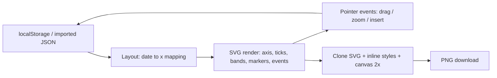

# Interactive Timeline

English | [中文](README.md)

A **double-click-and-use** interactive timeline in a single HTML file. Zero dependencies, no build step, works offline. Lay out a plan with the mouse in the browser and export a PNG for notes or sharing.


## Features

- **Single file**: the whole app is one `index.html` (~38 KB) — no build, no CDN, no backend, works offline
- **Multiple timelines**: switch / create / rename / delete from the top dropdown; data lives in `localStorage` with JSON export
- **Flat structure**: event points plus optional "phase" bands — no parent/child hierarchy
- **Free placement**: each event can sit above or below the axis at any distance; in auto mode they alternate and stagger when dates are close
- **Vertical connectors**: a straight stem drops from the date on the axis to the event box, which is centered on its date
- **Phase dividers**: add any number of dashed markers, name them, color them, drag them to another date
- **Direct editing**: click the axis to insert an event at that date; drag an event sideways to change its date, vertically to flip side and distance; edit title / note / color in the side panel
- **PNG export**: exports the whole timeline at 2x, background follows the current theme
- **Dark / light theme**: one click in the header

## Quick start

1. Download `index.html`
2. Open it in a browser (Chrome / Edge / Firefox)
3. Click the axis to add your first event, then drag things around

Nothing to install.

## Controls

| Action | Effect |
| --- | --- |
| Click the axis | Insert an event at that date |
| Drag event sideways | Change its date (snaps to day) |
| Drag event vertically | Switch side and change distance from the axis |
| Drag a dashed marker | Change that marker's date |
| Drag empty space | Pan |
| Wheel | Zoom around the cursor |
| Double-click empty space | Fit the whole timeline |
| Click event / band / marker | Open its form in the side panel |
| `0` / `+` / `-` / `Esc` | Fit / zoom in / zoom out / deselect |

## Data format

Stored under the `timeline.app.v1` key in `localStorage`, exportable as JSON:

```json
{
  "lists": [
    {
      "id": "abc1234",
      "name": "My timeline",
      "events": [
        { "id": "e1", "title": "Mid-term review", "date": "2026-11-15",
          "note": "", "side": "up", "dist": 90, "color": "#7c8cff" }
      ],
      "phases": [
        { "id": "p1", "name": "Phase 1", "start": "2026-10-18", "end": "2026-11-17",
          "color": "#7c8cff" }
      ],
      "markers": [
        { "id": "m1", "name": "Month end", "date": "2026-11-17", "color": "#f2777a" }
      ]
    }
  ]
}
```

- `side`: `auto` (alternate) / `up` / `down`
- `dist`: distance in pixels from the axis to the event center; only used when `side` is `up` / `down`

## How it works

An SVG canvas plus plain front-end state — no libraries:



| Step | Approach |
| --- | --- |
| Time mapping | `x = (t - t0) / day * kx`, with `kx` derived from the total span so short spans do not crowd and long spans do not stretch |
| Stacking | explicit `side` uses `dist` directly; `auto` alternates sides and pushes outward on collision |
| Dragging | horizontal delta becomes a date, vertical delta becomes side and distance, committed on pointer-up |
| Zoom | anchor at the cursor by adjusting `translate + scale`, clamped to 0.25–3.2 |
| PNG export | clone the `world` group, inject inline `<style>` with resolved CSS variables, serialize to SVG → `img` → canvas 2x → Blob |

## Exporting images and the Windows security prompt

When the app is opened **from a local file** (`file://`), a browser download gets the region mark `ZoneId=4` (Restricted sites). Windows then treats the file as blocked and shows "blocked by Windows Security" when you open it.

The app now calls the **File System Access API** (`showSaveFilePicker`) first, so the browser **writes the file directly to disk** — no download pipeline, no region mark, nothing gets blocked. Only browsers without the API (e.g. Firefox) fall back to a normal download.

To unblock files you already have:

- Right-click the file → **General** tab → at the bottom, next to "Security: This file came from another computer and might be blocked" → tick **Unblock** → Apply / OK
- PowerShell: `Get-ChildItem "$HOME\Downloads\*.png" | Unblock-File`

Both do the same thing: delete the `Zone.Identifier` NTFS alternate data stream. The file content is untouched (verified: tag a file with `ZoneId=4`, unblock it, the stream disappears and the bytes stay identical).

### Why it keeps coming back

Every **new download** is tagged again, and a file with the same name is not overwritten — the browser writes a copy like `xxx (1).png`, which is a new file and carries the mark as well. So with an older build of this app, or a browser without `showSaveFilePicker`, the problem reappears on every export. The current build writes straight to disk and produces no mark.

### No checkbox, or ticking it does nothing

| Situation | What you see | What to do |
| --- | --- | --- |
| File on a USB stick (FAT32/exFAT) or a network path | Alternate data streams cannot be stored, so there is no mark at all | Nothing to unblock; it will not be blocked |
| File is read-only or held open by another program | Applying the change fails | Clear read-only / close the program, then retry |
| Group policy or a security product disabled Attachment Manager | The security line is missing entirely | Allow it in Windows Security, or use PowerShell |
| Still blocked after ticking | Explorer caches the state | Reopen the Properties dialog, or use `Unblock-File` |
| Blocked by Smart App Control / Controlled folder access | There is no checkbox at all | This is not a zone-mark issue — allow it in Windows Security |

To check whether a file is tagged:

```powershell
Get-Item "$HOME\Downloads\timeline-2026-10-18.png" -Stream Zone.Identifier
```

### Security boundary: never unblock programs

Mark-of-the-Web is a **trust signal**. SmartScreen reputation checks, Defender ASR rules (e.g. "Block executable content from email and webmail"), Office Protected View and script-host origin checks all depend on it.

- ✅ Unblocking **data files** (png / jpg / pdf / txt) has negligible impact; the real risk with images is decoder vulnerabilities, which are unrelated to the mark
- ❌ Unblocking **exe / msi / ps1 / bat / js / hta / docm / xlsm** bypasses those protections by hand — don't
- ❌ Don't add your downloads folder to Defender exclusions or turn off "Open File - Security Warning" just to make images open

### Note: storage sharing under `file://`

When the app is opened as a local file, all local HTML documents share one storage origin, so **any other local HTML file you open can read and modify this app's data**.

- Only open local HTML files you generated or can read through
- Export the JSON backup regularly (files on disk are unaffected)
- This app makes no network requests at all (no `fetch` / `XMLHttpRequest` / external scripts), so it never sends data anywhere

## Limitations

- Data lives in **browser storage**: switching browsers, clearing site data or private mode loses it — export JSON for backup
- With `showSaveFilePicker` you pick a save location once; browsers without it download directly (and may trigger the region-mark prompt above)
- Some browsers block storage on `file://`; the app then shows a banner and only JSON backup works
- Day-level precision only, no hours/minutes
- No Markdown import, no multi-lane Gantt view
- Single-file implementation, no automated tests

## License

[MIT](LICENSE)
