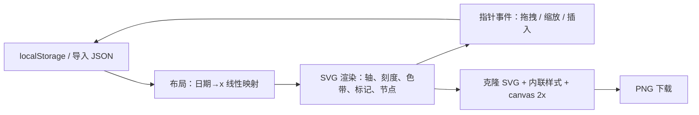

# Interactive Timeline · 交互式时间轴

[English](README.en.md) | 中文

一个**双击即用**的交互式时间轴工具：单文件 HTML、零依赖、离线可用。用鼠标在浏览器里直接排计划，导出一张 PNG 就能贴进笔记或发给别人。


## 特性

- **单文件**：整个应用就是一个 `index.html`（约 38 KB），没有构建、没有 CDN、没有后端，断网也能用
- **多份时间轴**：顶部下拉切换 / 新建 / 重命名 / 删除，数据存在浏览器 localStorage，可导出 JSON 备份
- **扁平结构**：事件点 + 可选「阶段色带」，没有父子层级
- **自由摆放**：事件可指定在轴上方或下方，并可调离轴距离；自动模式下上下交替、日期过近自动错行
- **竖直连线**：从轴上的日期点垂直连到节点框，节点框以日期居中
- **阶段分隔**：可添加任意多条虚线标记，命名、改色、左右拖动改日期，用来划分阶段
- **直接编辑**：点轴线在该日期插入节点；左右拖节点改日期，上下拖改上下侧与距离；右侧表单改标题 / 备注 / 颜色
- **导出图片**：整张导出 PNG，2 倍清晰度，背景跟随当前主题（深色 / 浅色）
- **深浅主题**：右上角一键切换

## 快速开始

1. 下载 `index.html`
2. 双击用浏览器打开（Chrome / Edge / Firefox 均可）
3. 点轴线插入第一个节点，剩下的靠拖

不需要安装任何东西。

## 操作

| 操作 | 效果 |
| --- | --- |
| 点击轴线 | 在该日期插入新节点 |
| 左右拖节点 | 改日期（吸附到天） |
| 上下拖节点 | 换到轴上方 / 下方，并改变离轴距离 |
| 左右拖虚线标记 | 改该标记的日期 |
| 拖空白 | 平移画布 |
| 滚轮 | 以光标为中心缩放 |
| 双击空白 | 全览（fit） |
| 点节点 / 色带 / 标记 | 右侧打开编辑表单 |
| `0` / `+` / `-` / `Esc` | 全览 / 放大 / 缩小 / 取消选中 |

## 数据结构

数据存在 `localStorage` 的 `timeline.app.v1` 键下，可整体导出为 JSON：

```json
{
  "lists": [
    {
      "id": "abc1234",
      "name": "我的时间轴",
      "events": [
        { "id": "e1", "title": "中期检查", "date": "2026-11-15",
          "note": "备注", "side": "up", "dist": 90, "color": "#7c8cff" }
      ],
      "phases": [
        { "id": "p1", "name": "第一阶段", "start": "2026-10-18", "end": "2026-11-17",
          "color": "#7c8cff" }
      ],
      "markers": [
        { "id": "m1", "name": "月底收口", "date": "2026-11-17", "color": "#f2777a" }
      ]
    }
  ]
}
```

- `side`：`auto`（自动上下交替）/ `up` / `down`
- `dist`：节点中心到轴线的像素距离，仅 `side` 为 `up` / `down` 时生效

## 实现原理

一个 SVG 画布 + 纯前端状态，没有任何依赖：



| 环节 | 做法 |
| --- | --- |
| 时间映射 | `x = (t - t0) / 天 * kx`，`kx` 按整体跨度自适应，短跨度不挤、长跨度不散 |
| 竖直堆叠 | 显式指定 `side` 时直接用 `dist`；`auto` 时按上下交替 + 同侧碰撞检测逐行外推 |
| 拖拽 | 水平位移换算成日期，垂直位移换算成侧别与距离，松手一次性写回数据 |
| 缩放 | 以光标为锚点调整 `translate + scale`，缩放范围 0.25–3.2 |
| 导出 PNG | `world` 组克隆后注入内联 `<style>`（颜色取自已解析的 CSS 变量），序列化成 SVG → `img` → canvas 2x → Blob |

## 导出图片与 Windows 的「安全中心」提示

从**本地双击打开**（`file://`）时，浏览器给下载的文件打上的区域标记是 `ZoneId=4`（受限制站点），Windows 会因此认为文件「被阻止」，打开时弹「安全中心已阻止此文件」。

现在的做法是：导出优先调用 **File System Access API**（`showSaveFilePicker`），让浏览器**直接写盘**，不经过下载流水线，因此不会产生任何区域标记，也不会被拦。只有浏览器不支持该 API（如 Firefox）时才退回普通下载。

如果已经有被拦的旧文件，任选一种解除：

- 右键文件 → 属性 → **常规** 选项卡最底部「安全：此文件来自其他计算机，可能被阻止」→ 勾选「**解除锁定**」→ 应用 / 确定
- PowerShell：`Get-ChildItem "$HOME\Downloads\*.png" | Unblock-File`

两种做法等价：都是删掉 `Zone.Identifier` 这个 NTFS 附加数据流，文件内容不受任何影响（实测：打上 `ZoneId=4` 再解除，流消失、内容不变）。

### 为什么「锁回去」会反复出现

浏览器每次**新下载**都会重新打标记，而且同名文件不会覆盖，会生成 `xxx (1).png` 这类副本——副本是一份新文件，同样带标记。所以用旧版本导出、或浏览器不支持 `showSaveFilePicker` 时，这个问题每次导出都会重现一次；现在这版直接写盘，不再产生标记。

### 勾选框没有 / 勾了没用

| 情况 | 表现 | 处理 |
| --- | --- | --- |
| 文件在 U 盘（FAT32/exFAT）或网络位置 | 存不下附加数据流，本来就没有标记 | 不需要解锁，也不会被拦 |
| 文件只读，或正被其他程序占用 | 点确定时提示失败 | 取消只读、关掉占用程序后重试 |
| 组策略 / 安全软件禁用了「附件管理器」 | 整行安全提示不出现 | 在 Windows 安全中心放行，或直接用 PowerShell |
| 勾选后仍然被拦 | 资源管理器有缓存 | 关闭属性窗口再打开确认；或改用 `Unblock-File` |
| 被 Smart App Control / 受控文件夹访问 拦的 | 属性里根本没有勾选框 | 这不是来源标记问题，需要在安全中心里放行 |

排查用：

```powershell
# 该文件是否带来源标记
Get-Item "$HOME\Downloads\示例时间轴-2026-10-18.png" -Stream Zone.Identifier
```

### 安全边界：别把「解除锁定」用在程序上

来源标记（Mark-of-the-Web）是一条**信任信号**，SmartScreen 信誉检查、Defender 的 ASR 规则（例如「阻止来自电子邮件和 Web 邮件的可执行内容」）、Office 保护视图、以及脚本宿主的来源判定都依赖它。

- ✅ 对**数据文件**（png / jpg / pdf / txt）解除锁定：影响可以忽略。图片真正的风险是解码器漏洞，那与标记无关
- ❌ 对 **exe / msi / ps1 / bat / js / hta / docm / xlsm** 解除锁定：等于亲手绕过上述保护，不要做
- ❌ 也不要为了让图片能打开，就把下载目录加进 Defender 排除项，或关闭「打开文件 - 安全警告」

### 附：`file://` 打开的存储共享

双击本地 HTML 打开时，所有本地 HTML 共享同一个存储源。因此**你打开的任何其他本地 HTML 文件都能读取、改写本应用的数据**。

- 只打开自己生成或看得懂的本地 HTML
- 重要数据定期「备份 JSON」到磁盘（磁盘文件不受影响）
- 本应用零网络请求（无 `fetch` / `XMLHttpRequest` / 外链脚本），不会外传数据

## 已知限制

- 数据存在**浏览器本地**。换浏览器、清站点数据、隐私模式都会丢；重要内容请定期「备份 JSON」
- 导出走 `showSaveFilePicker` 时需要你选一次保存位置；不支持的浏览器会直接下载（此时可能触发上面的区域标记提示）
- 双击打开（`file://`）时 storage 被禁的浏览器会顶部提示，此时只能用 JSON 备份
- 时间精度到天，不支持时分
- 不支持导入 Markdown、不支持甘特式多泳道
- 单文件实现，没有自动化测试

## License

[MIT](LICENSE)
